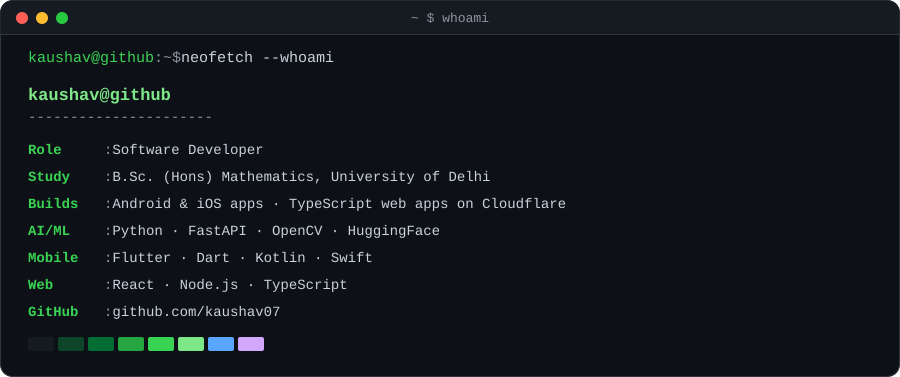

### `~/ about.txt`

I build products that sit between AI, mobile and the web.

- 💻 Software Developer Engineer at **Pine Careers**: iOS apps and TypeScript web apps on Cloudflare
- 📐 Studying Mathematics at the University of Delhi
- ☕ I convert caffeine into code

### `~/ stack`

### `~/ projects`

- [**VisionMate**](https://github.com/kaushav07/VisionMate) · Python
- [**celestial-engine**](https://github.com/kaushav07/celestial-engine) + [frontend](https://github.com/kaushav07/CelestialEngine-frontend) · Python, TypeScript
- [**image-to-latex**](https://github.com/kaushav07/image-to-latex) + [backend](https://github.com/kaushav07/image-to-latex-backend) · Python
- [**misinformation-ai**](https://github.com/kaushav07/misinformation-ai) · Python
- [**what-am-i-missing**](https://github.com/kaushav07/what-am-i-missing) · Python
